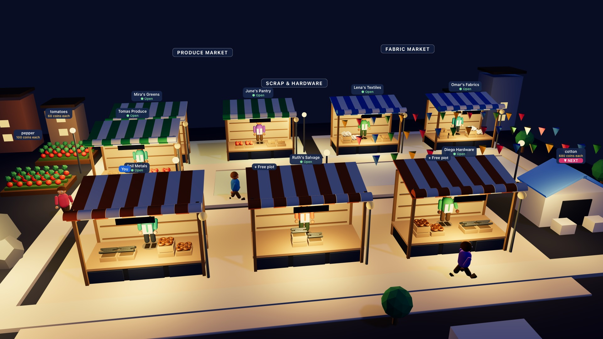
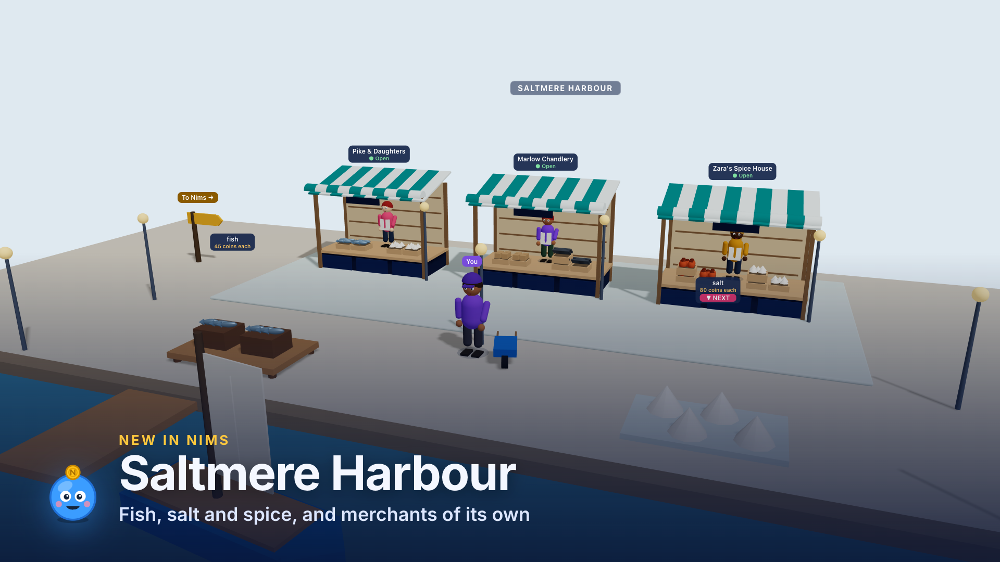
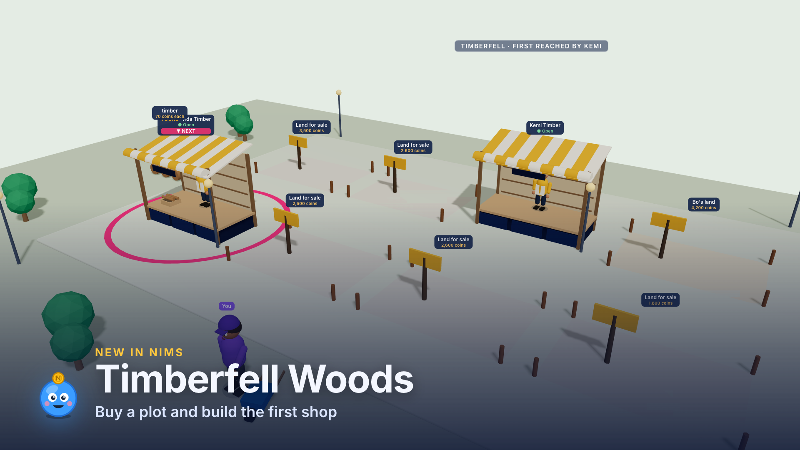
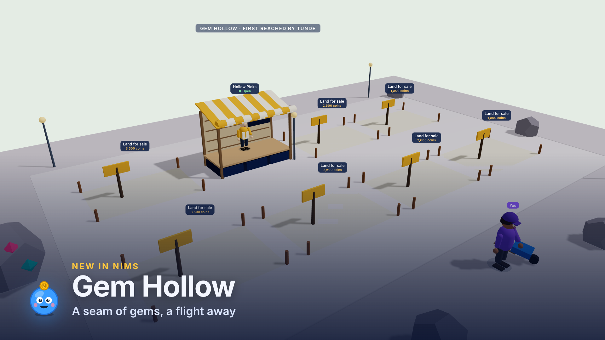
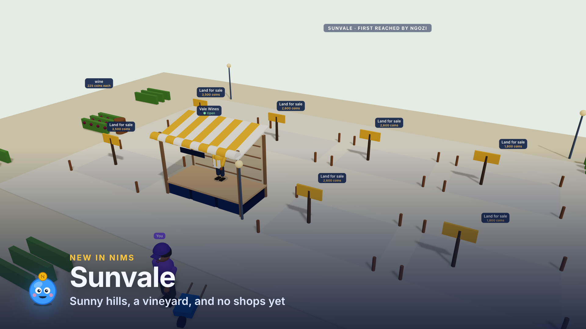
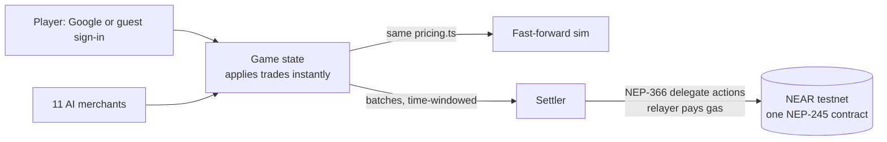

<div align="center">


# Nims

**A market town where every trader is an AI agent with its own money, its own stock and its own pricing.**

[Play it live](https://nims-app.up.railway.app) · [Who is playing: the town board](https://nims-app.up.railway.app/#town) · [Demo video (3:09)](docs/nims-demo.mp4) · [New places (47 s)](docs/nims-new-places.mp4) · [Judge walk-through](docs/DEMO.md) · Contract: `oja-items.testnet`

   

</div>

**What it is.** Nims is a market town where eleven AI merchants (eight in town, three in Saltmere Harbour), each with its own NEAR account, stock, cash and prices, plan their days and trade with real people. Track: **Games With Real Economies** (`games`); the bounded-agent design also fits `security`. Players never see the chain.

**The problem.** Game economies are usually scripts: prices follow a table, NPCs hold no money, and nothing changes until the next dev patch. And handing an AI agent real money is unsafe, because a model can be talked into anything.

**The idea: a model steers, code bounds.** Each morning every merchant asks NEAR AI Cloud for a plan, and the game turns it into one fixed step: stock target x1.3, x0.75 or unchanged, and margin +3 or -3 points, kept between 5% and 25% ([`sim/plan.ts#L29-L32`](sim/plan.ts#L29-L32)). A reply that is not a valid plan is ignored, and a reason that invents a number is replaced by the game's own words ([`server/agents/planner.ts#L11`](server/agents/planner.ts#L11), tested in [`planner.test.ts#L24-L37`](server/agents/planner.test.ts#L24-L37)). The merchant is told nothing about any player ([`planner.test.ts#L41`](server/agents/planner.test.ts#L41)), and no player-typed text reaches any prompt: the plan, the price explanation, the gazette and the haggle reply are all built from the game's own facts ([`planner.ts#L13`](server/agents/planner.ts#L13), [`voice.ts#L12`](server/voice/voice.ts#L12), [`gazette.ts#L8`](server/voice/gazette.ts#L8), [`haggle.ts#L11-L25`](server/voice/haggle.ts#L11-L25)). So an agent can run a real business on a real account without being able to break the economy. The same shape fits anywhere an agent needs a budget; [docs/BOUNDED-AGENTS.md](docs/BOUNDED-AGENTS.md) writes the pattern down as six rules, with the file and test for each, so another team can reuse it.

**Try it.** Live: <https://nims-app.up.railway.app>
1. Press **Play as a guest** (or **Continue with Google**). You see the town and a goal card. No wallet, popup or gas prompt appears.
2. Collect goods at the tomato field, open **Mira's Greens** and sell some. Your cash rises at once. The stall panel shows **Today's plan**, in the merchant's own words, and hovering a price tells you why it is what it is.
3. Open the **News** tab and press **See them on the public ledger** ([`NewsFeed.tsx#L18`](web/src/game/NewsFeed.tsx#L18)): your goods and coins are NEP-245 balances on testnet. Open `/chain/status` to see settlement running (`lastSettledAt` keeps moving).
4. Open the [town board](https://nims-app.up.railway.app/#town) (no login) to see who is playing: people who have played, trades and players in the last 24 hours, the richest traders (all time or the last 24 hours), the council decisions with their SputnikDAO proposal numbers, and a short "What this shows" summary. The same numbers are JSON at [`/stats`](https://nims-app.up.railway.app/stats).

**NEAR, concretely.**
- **NEP-245 items:** every good and the `coins` token live in one contract, `oja-items.testnet` ([`contracts/items/src/lib.rs#L5-L7`](contracts/items/src/lib.rs#L5-L7)). Calls carry sequence numbers, so a retry can never apply twice.
- **Players never sign:** the server signs a NEP-366 delegate action with the player's key and a relayer pays the gas ([`server/chain/agent-chain.ts#L37-L48`](server/chain/agent-chain.ts#L37-L48), [`relay.ts#L22-L26`](server/chain/relay.ts#L22-L26)).
- **Council record:** every town-council vote is written to a SputnikDAO, `nims-council.sputnikv2.testnet` ([`server/chain/dao.ts#L37-L80`](server/chain/dao.ts#L37-L80)).
- **OutLayer:** the Town Clerk that signs that record has a key custodied by OutLayer, with a policy that allows only calls to the DAO within spending caps. The policy is set in the OutLayer dashboard, and `npm run chain:outlayer -- check` prints the live one ([`server/chain/outlayer.ts`](server/chain/outlayer.ts)).

**Honest limits.**
- Merchant and player keys are held by the server (encrypted), not by the merchants themselves. Only the Town Clerk is OutLayer-custodied.
- NEAR Intents is partial: delivery orders take its shape but run inside the game.
- The DAO is a record. Votes are counted in the game.
- Settlement mirrors the game to testnet in the background and never blocks play. After a deploy, or if NEAR rejects a call, it starts a fresh epoch (a new namespace on the same contract), so the epoch number in `/chain/status` can change. Run only one server per contract.
- Testnet only. Coins are the game's own currency and are never cashed out. Details: [What is real, and what is not](#what-is-real-and-what-is-not).

## What is in the game

- **Eleven merchant agents** (eight in town, three in Saltmere Harbour) each hold their own goods and coins, and set their own prices from their stock, their cash and what was traded recently. **Each morning every merchant plans its own day through NEAR AI Cloud:** told its real books and the town around it, it decides which goods to stock up on or run down and whether to price keener or wider, and says why (from a live run: *"I am stocking up on 49 pepper while the price is low at 147 coins to prepare for the festive season crowds."*). The game turns those choices into small, bounded adjustments, so a merchant steers its business but can never break the economy.
- **Prices explain themselves, out loud.** Hover a price and the merchant says why, in their own voice: *"It is the festive season and everyone wants fabric right now."* The words come from **NEAR AI Cloud**, checked against the game's real numbers, and are spoken with ElevenLabs.
- **Merchants talk back.** Haggle once an hour and the merchant answers in character (cautious, greedy or loyal), and the town gazette prints what really happened: dividends, a merchant that stopped buying, a week of rain.
- **Merchants notice being played off each other.** Sell the same good to two different merchants in a market within a few hours, and a third one there holds firmer prices with you specifically — both paying you less and charging you more — and says so: *"Word's got round that you're playing us off each other on iron, so we're holding firmer prices for now."* It fades once you stop; it never touches another player, a different good, or a merchant you haven't shopped around on. Code: `shoppedAroundWith` in [`sim/engine.ts`](sim/engine.ts), the `wary` term in [`merchants/pricing.ts`](merchants/pricing.ts).
- **Players move markets.** Flooding one good crashes its price for everyone. A merchant that runs out of cash and stock closes; a community fund can reopen it. Carrying goods to another market costs a fare that is a small share of what they are worth (3% of the usual price), cheaper in a pickup or a van.
- **Players own parts of the economy.** Buy up to 49% of a merchant for a share of its nightly profit, or open a stall and set your own prices. A purchase is priced on the merchant after your money is in its till, so buying and selling straight back is a wash and nobody can make coins by moving the price. Dividends go only to shares held since the day began.
- **Stores stay in business.** Wholesalers charge relative to the going price (they used to charge a fixed amount, which bankrupted every merchant whose goods gatherers kept cheap). Merchants spend surplus cash on upkeep each evening, so a share stays at a price a new player can reach however long the town has been running, and that upkeep is shared out to merchants that are running low (the merchants' guild). A test runs the town for 120 simulated days and checks that no store is closed more than 2% of the time or low on cash more than 5% of it ([`sim/guild.test.ts`](sim/guild.test.ts)).
- **Shareholders run the markets.** Each market has a town council. Players vote on its stall rent and on how much profit merchants share out. Trading in a market gives you a seat there, and each share you hold adds another, so a new player can vote without buying a share. The merchants vote too (they oppose anything that costs them). A passing vote changes how the economy runs from the next day, with no dev patch. Extra rent is paid to shareholders each evening; every coin stays on the ledger. Code: [`sim/council.ts`](sim/council.ts).

**Around the economy** (what makes it a game you can play for an hour):

- **A 3D town.** The game opens in a 3D town (React Three Fiber): stalls with real goods in their crates, shopkeepers and townsfolk, day and night, rain. The townsfolk walk only on paved walkways and stop in front of stalls and sources, and a test simulates them to check they never touch a building. Click a stall, source or free plot and you walk the same streets there and stand facing it, instead of staying pinned to one spot; the 2D map glides to the same kind of spot, just without the full walk. Phones (700 px wide or narrower) always use the 2D map; tablets, small windows, reduced-motion settings and browsers without WebGL start on it too, a button on the map switches either way, and the game remembers your choice. If the 3D town ever fails to start, the 2D map takes over. If it opens in 3D on its own and runs slowly (under about 22 frames a second over the first few seconds), the game drops to the 2D map, says so, offers **Try 3D anyway**, and does not try again by itself on that browser. A view you chose yourself is never overridden.
- **A world beyond the town.** Take the road out of Nims to **Saltmere Harbour**: a journey of 6 game hours (about a minute) that costs a passage plus freight on what you carry, and you can't trade on the road. The harbour has its own merchants (fish and salt, a chandlery, a spice house), a fishing pier and salt pans, drawn in 2D and 3D with the sea and boats. Distance makes goods dear: the harbour pays 1.5x for thread and iron from town, the town pays 1.6x for spice and 1.3x for salt from the harbour, so goods are worth carrying both ways. Code: [`sim/world.ts`](sim/world.ts) (realms and prices), `Game.travel` in [`server/game/game.ts`](server/game/game.ts).
- **Three unexplored frontiers to settle.** Timberfell Woods (by car), Gem Hollow and Sunvale (by plane) have no shops at all, just 8 plots of land each and a source of their own (timber, gems, wine). Buy a plot where you are (one per place; the plots by the source cost more), build a business on it, stock it and set its prices, and the people there buy from you; they pay more for what their place lacks. Put empty land up for sale and another player can buy it from you. The first to reach each frontier is named in the news. Code: `buyLand`, `listLand` and `build` in [`server/game/game.ts`](server/game/game.ts), plots in [`sim/world.ts`](sim/world.ts).
- **Quests, daily rewards and invites for new players.** A starter quest chain teaches the first ten minutes (first haul, first sale, a haggle, two markets, a share, a council vote) and a realm chain sends you to the harbour and back with spice, and an explorer chain takes you to a frontier to buy land and open a business; each pays a small reward when claimed. A daily reward grows for 7 days in a row. Invite a friend with your link, and when they make their first sale you each get 300 coins (up to 10 friends). Every reward is paid through the ledger. Code: [`server/game/quests.ts`](server/game/quests.ts).
- **Create your trader.** A new player picks a look (skin, hair, hairstyle, shirt, cap) and a name before trading; it shows in the 2D and 3D towns and on the town board. Code: [`web/src/game/AvatarCreator.tsx`](web/src/game/AvatarCreator.tsx).
- **See who else is playing.** Everyone signed in right now shows up live in the town, standing wherever they actually are; click them for their name, rank, net worth, vehicle and shares — the same stats the town board shows, never an email. A player mid-journey isn't shown (there's no road to stand them on), and the list clears itself 60 seconds after someone stops playing. Code: `onlinePlayers` in [`server/game/game.ts`](server/game/game.ts), [`web/src/game/Panels.tsx`](web/src/game/Panels.tsx).
- **A way back from broke.** Nearly out of coins with nothing to sell? Search the scrap heap, or take an odd job: a merchant who is short of a good pays you to fetch it, and pays the cost and your reward from their own till. Jobs are open only while you are short of coins, with a cooldown, so they are a way back up and not a way to farm.
- **Delivery orders.** State the goods and the lowest price you will take; the town's carriers (a solver run by the game) sell for you when the price allows.

The chain is invisible: continue with Google or play as a guest in one press, no wallet, no seed phrase, no gas prompt.

<table>
<tr>
<td colspan="2"><br /><sub><b>The town at night, in 3D.</b> Lamp-lit stalls, shopkeepers, and townsfolk who walk the paths and stop to shop. Every stall and price is real game state.</sub></td>
</tr>
<tr>
<td width="50%"><br /><sub><b>A stall.</b> Hover a price and the merchant explains it in their own words (NEAR AI). Buy, sell, haggle, place a delivery order, buy shares.</sub></td>
<td width="50%"><br /><sub><b>The price board.</b> Every good in every market against its usual price: dear, cheap, or about usual.</sub></td>
</tr>
<tr>
<td width="50%"><br /><sub><b>Today's plan.</b> Each morning the merchant reads its own books and decides, through NEAR AI Cloud, what to stock up on or run down and how hard to price. A real reply, from a local test game.</sub></td>
<td width="50%"><br /><sub><b>The town board.</b> Public, no login (<code>#town</code>): who is playing, the richest traders and every council decision. Shown here from a local test game with six test players.</sub></td>
</tr>
<tr>
<td width="50%"><br /><sub><b>The town council.</b> Trade in a market and you get a seat. A vote to cut the rent, with the merchants' stance. It passes at the end of the day, with no dev patch.</sub></td>
<td width="50%"><br /><sub><b>On the record.</b> Every vote is also written to a SputnikDAO on testnet by an OutLayer-custodied Town Clerk. This is a real proposal from the demo's own vote.</sub></td>
</tr>
<tr>
<td colspan="2"><br /><sub><b>Fast-forward a week.</b> The same economy, run headless and replayed: a flooder crashes iron to 30% of its usual price, every shop stays open, shareholders are paid each evening.</sub></td>
</tr>
</table>

**Beyond the town.** Saltmere Harbour and the three frontiers, drawn from the real game ([47-second video](docs/nims-new-places.mp4)):

<table>
<tr>
<td width="50%"></td>
<td width="50%"></td>
</tr>
<tr>
<td width="50%"></td>
<td width="50%"></td>
</tr>
</table>

## How NEAR is used

| Piece | NEAR feature | Where |
|---|---|---|
| Every good and the `coins` token | One **NEP-245** multi-token contract (no per-item contracts), deployed as `oja-items.testnet` | [`contracts/items/`](contracts/items/) |
| Player accounts | Created behind Google or guest sign-in; keys held encrypted by the server | [`server/accounts/accounts.ts`](server/accounts/accounts.ts) |
| Gas | A relayer pays through **NEP-366** delegate actions: each merchant or player signs its own `send_many` as a delegate action, and the relayer submits it and pays the gas | [`server/chain/agent-chain.ts`](server/chain/agent-chain.ts) (the live settler), [`server/chain/relayer.ts`](server/chain/relayer.ts) (single transfers when the settler is off) |
| Merchant agents | Each has its own account and signs its own transfers | [`merchants/agents/`](merchants/agents/), [`server/chain/rounds.ts`](server/chain/rounds.ts) |
| Settlement | Trades apply instantly in the game, then settle to the chain in merged batches with per-signer sequence numbers, so a retry can never apply twice | [`server/chain/chainsync.ts`](server/chain/chainsync.ts) |
| Merchant agents (optional) | **NEAR AI Cloud** plans each merchant's day: which goods to stock up on or run down, and keener or wider prices, with a reason. The game bounds every choice and ignores a reply that fails its checks; without NEAR AI the merchants keep their usual settings. `MERCHANT_AGENTS=0` turns it off | [`server/agents/planner.ts`](server/agents/planner.ts), [`sim/plan.ts`](sim/plan.ts) |
| Haggling reactions (optional) | **NEAR AI Cloud** writes the merchant's reaction when a player wins a haggle (grudging if cautious, grumbling if greedy, warm if loyal). The game has already decided the deal; the line is checked against its numbers | [`server/voice/haggle.ts`](server/voice/haggle.ts) |
| Town gazette (optional) | **NEAR AI Cloud** turns the town's latest events into a few newspaper headlines in the News tab. Same rules as the merchant voice: facts only from the game, every number checked, plain event list as the fallback | [`server/voice/gazette.ts`](server/voice/gazette.ts) |
| Merchant voice (optional) | **NEAR AI Cloud** (OpenAI-compatible API) rewrites a merchant's price reasoning in their own words when a player hovers a price. Prices never depend on it: the reply is used only if every number matches `pricing.ts`, and the plain explanation shows otherwise. Set `NEAR_AI_API_KEY` to turn it on. The line is also spoken aloud: with **ElevenLabs** natural voices (one stock voice per merchant) when `ELEVENLABS_API_KEY` is set, otherwise with the browser's built-in speech. It follows the sound switch | [`server/voice/voice.ts`](server/voice/voice.ts), [`llm.ts`](server/voice/llm.ts) |
| Council record (optional) | Every town-council vote is also written to a **SputnikDAO** on testnet (`nims-council.sputnikv2.testnet`): a Vote proposal when it opens, approved or rejected when it closes, so the decisions are public. **The game counts the votes and stays the authority; the DAO is only the record.** Player names are never written. Calls retry with back-off and never block gameplay | [`server/chain/dao.ts`](server/chain/dao.ts) |
| Town Clerk (optional) | An agent wallet custodied by **OutLayer** (testnet): its key lives in a secure enclave and the server holds only an API key. It is the DAO's only council member and signs the record. Its OutLayer policy, set in the OutLayer dashboard rather than in this repo, allows only contract calls, only to the DAO account, within spending caps (1.5 NEAR per call, 10 per hour, 30 per day); transfers, withdrawals and everything else are denied. `npm run chain:outlayer -- check` prints the live policy. **The merchants' own accounts are not custodied this way: the server still holds their keys** | [`server/chain/outlayer.ts`](server/chain/outlayer.ts) |
| Delivery orders | Intents-style: state the outcome and a limit price, a solver fills it. Implemented inside the game (`Game.placeOrder`, `fillOrders`) | [`server/game/game.ts`](server/game/game.ts) |

NEAR **testnet only**. No mainnet or real funds are used.

## Try it

**Live (no setup):** <https://nims-app.up.railway.app>. Do each step, then look for the result.

1. Press **Continue with Google**, or **Play as a guest**. See the town map with a goal card and a next-step hint from Nim. No wallet or popup appears.
2. Click the **Wholesaler (cotton)**, press **Collect cotton**. See your cash drop and the wheelbarrow fill.
3. Click **Lena's Textiles** and hover a price. See the merchant explain it in their own voice (sound on for the spoken line).
4. Tick **Haggle** and press **Sell**. See your cash rise at once and the merchant answer in character; the game never waits for a block.
5. In the stall panel, place a **delivery order** (goods and a lowest price). See the carriers sell the load and your cash rise when the price allows.
6. Run low on coins with nothing to sell, then open **Deals** and its **Odd jobs** tab. See the scrap heap and merchants offering to pay you to fetch what they lack.
7. Open the **News** tab. See the town gazette and the plain list of events.
8. Open **Fast-forward** (or add `#sim` to the address, no login). See a simulated week as price and shop-cash charts, driven by the same pricing code as the live game.
9. Open `/chain/status` on the live address. See the contract, the settlement namespace, and how far settlement has got. `behind` counts game ledger entries not yet on chain. Settlement works through the game in windows of 6 game hours (one real minute), widening up to 96 when it falls behind ([`chainsync.ts`](server/chain/chainsync.ts)), so `behind` rises and falls with each window instead of sitting at zero; `lastSettledAt` moving shows it is keeping up.
10. Open the **[town board](https://nims-app.up.railway.app/#town)** (`#town` on the live address, or **See who's playing** on the sign-in screen; no login). See how many people have played, trades and players in the last 24 real hours, council votes passed, shops open, the ten richest traders (all time, or only those who played in the last 24 hours) and the latest council decisions, then a short "What this shows" summary built from the same live numbers. It counts only signed-in people and never shows an email: players appear, here and in the game, by the name they chose in **My business**, or else by a first name from their email, or only an initial when the email's username is one word and may hold a surname ([`web/src/town/TownBoard.tsx`](web/src/town/TownBoard.tsx), [`server/game/activity.ts`](server/game/activity.ts)); the same numbers are JSON at `/stats`.

**Locally:**

```bash
npm run setup     # installs the server and the web app
npm run dev       # starts both; open the address Vite prints (usually http://localhost:5173)
```

**The newest parts** (council, 3D view):

1. Collect some goods (the tomato field, say) and sell one unit to a merchant in the Produce Market. You are now a regular there.
2. Open **My business → Town council → Produce Market**. It shows your seat. Press **Low** under **Stall rent**. The merchants back a cut, so it passes at the end of the game day (use `TICK_MS=1000 npm run dev` to get there in a few minutes), and the news feed says so.
3. On a desktop browser the map opens in 3D (**2D map** switches to the flat map and back). Click a stall to open its panel. Drag to turn the view; watch the townsfolk walk to the stalls.
4. With `SPUTNIK_DAO_ID` (and optionally `OUTLAYER_API_KEY`) set, the same vote appears on the DAO: `npm run chain:dao -- proposals` lists it as Approved or Rejected. Proposal #0 on `nims-council.sputnikv2.testnet` is from a test run, not from real play; the later ones are from the demo and from play.

**Optional extras** (all off unless you set them in `.env`; see `.env.example`):

| Variable | What it turns on |
|---|---|
| `NEAR_AI_API_KEY` | NEAR AI Cloud plans each merchant's day (`MERCHANT_AGENTS=0` turns that off) and writes the merchant voice, the town gazette and haggling reactions. Key from [cloud.near.ai](https://cloud.near.ai). Optional `NEAR_AI_MODEL`. |
| `SPUTNIK_DAO_ID` | Records each council vote on this SputnikDAO (a `*.testnet` account). Make one with `npm run chain:dao -- create nims-council`. |
| `OUTLAYER_API_KEY` | Makes the OutLayer-custodied Town Clerk the one who calls the DAO. Run `npm run chain:outlayer -- register`, then `fund`, and set the wallet's policy in the OutLayer dashboard (call only, the DAO account only, spending caps). |
| `GOOGLE_CLIENT_ID`, `GOOGLE_CLIENT_SECRET` | Adds **Continue with Google** to the sign-in screen, beside **Play as a guest**. The player is matched by their verified Google email. Register `PUBLIC_URL/auth/google/callback` as the redirect in Google Cloud. |
| `ELEVENLABS_API_KEY` | Natural spoken merchants (one stock voice each). Without it the browser's own voice is used. Optional `ELEVENLABS_VOICES`, `ELEVENLABS_VOICE`, `ELEVENLABS_MODEL`. |
| `TICK_MS` | Real milliseconds per game hour (default 10000). Lower is a faster, twitchier market. |

Every one of these falls back to plain text and the browser voice, so the game plays the same without them.

No `.env` is needed. Without testnet credentials the game plays the same and does not settle to a chain. The game saves to `server/data/game.json` and resumes after a restart.

## Let an AI agent play

An AI agent plays Nims the way the web page does: over plain HTTP, with the same rules and the same prices as everyone else. There is no wallet to set up and no special API. Agents show up on the town board like any other trader.

```bash
node examples/agent.mjs                              # a small agent plays 20 turns on the live game
node examples/agent.mjs http://localhost:3000 30     # or on your own server
```

[`examples/agent.mjs`](examples/agent.mjs) has no dependencies (Node 18+). It signs in as a guest, collects goods where they are cheap, sells a few at a time to whichever stall here pays most, and holds when no stall pays more than the goods cost. In a 30-turn test against a local server it took net worth from 4,000 to 4,916 coins. Its `choose()` function is the place to plug in an LLM.

**1. Sign in.** `POST /auth/guest` returns a session cookie (`nims_session`). Send it on every request after that. One address can start 20 new guests an hour, so keep one session per agent.

**2. Read the game.** `GET /game/state` returns everything the player's screen shows, as JSON:

| Field | What an agent uses it for |
|---|---|
| `you` | Cash, net worth, what you carry (`inventory`), cart size (`capacity`), vehicle and upgrades |
| `deals` | Ready-made trades: where to collect a good (`from`), which stall pays more (`to`), and the profit per unit |
| `coach.text` | The next sensible step, in one sentence (the same hint a human player sees) |
| `stalls` | Every merchant: `market`, open or closed, and for each good `buyPrice`, `sellPrice`, stock, and `why` (the merchant's own reason for the price) |
| `sources` | Farms, scrap spots and wholesalers: price per unit and units left |
| `realm` | Where you are (`here`), the roads out (`roads`), and the trip in progress (`journey`) |
| `land`, `quests`, `council`, `events` | Plots for sale, quests to claim, council votes, and the town's news |

**3. Act.** `POST /game/<action>` with a JSON body. Every answer is `{ ok, message, state }`. A refused action answers 400, and the `message` says why ("You can't afford the fare…").

| Action | Body |
|---|---|
| `gather` | `{ "item": "cotton" }` collects as much as your cart and cash allow |
| `sell` / `buy` | `{ "merchant": "lena", "item": "cotton", "units": 4, "haggle": false }` (haggle once an hour for a better price) |
| `order` | `{ "merchant": "lena", "item": "cotton", "units": 10, "minPrice": 750 }`: a delivery order the town's carriers fill when the price allows |
| `travel` | `{ "realm": "saltmere" }` (also `timberfell`, `gemhollow`, `sunvale`, `town`). You can't trade until you arrive. |
| `land/buy`, `land/build` | `{ "plot": "timberfell-2" }`, then `{ "plot": "timberfell-2", "name": "Robo Timber" }` |
| `shares/buy`, `council/vote` | `{ "merchant": "ruth", "shares": 5 }`, `{ "market": "fabric", "yes": true }` |
| `upgrade`, `goal`, `name` | `{ "to": "pickup" }`, `{ "kind": "fortune" }`, `{ "name": "Robo" }` |
| `quest/claim`, `daily` | `{ "id": "first-haul" }`, `{}` |

**Things an agent should know:**

- **Time:** one game hour passes every 10 real seconds.
- **Prices react to you:** a merchant pays less with every unit you sell it and recovers over the next game hours, so dumping a full cart into one stall loses money. Spread sales out, or carry goods to where they're scarce.
- **Fares:** moving goods between markets costs a fare on what you carry.
- **Be polite with requests:** reading the state once a second is plenty.
- **LLM agents:** the easy setup is to give the model `coach.text`, `deals` and `you`, list the actions above, and ask it for one action as JSON each turn.

## How it works



**Pricing** lives in one pure function, [`merchants/pricing.ts`](merchants/pricing.ts): same inputs, same price, and it returns the reasoning lines shown in the tooltip.

```
scarcity  = (targetStock / max(stock, 1)) ^ elasticity
demand    = 1 + ((recentBuys - recentSells) / window) * demandWeight
mid       = clamp(basePrice * scarcity * demand, basePrice * minMult, basePrice * maxMult)
buyPrice  = mid * (1 - margin)     # what the merchant pays the player
sellPrice = mid * (1 + margin)     # what the merchant charges the player
```

Below its cash floor a merchant stops buying; at zero cash with nothing to sell it closes. Personality (cautious, greedy, loyal) changes only the parameters, never the formula, and so does a merchant's daily plan: it adjusts the target stock and the margin within fixed bounds ([`sim/plan.ts`](sim/plan.ts)).

**Design rules**

- One pricing file, one economy: fast-forward calls the same engine as the live game.
- Gameplay never waits on the chain. If the chain rejects a call, the settler starts a fresh epoch minted from the game state instead of patching.
- A redeploy tries not to cost a new epoch: the settler never sends anything the saved game does not contain, and on a stop signal it finishes the call in flight and saves before exiting. **On the hosted demo it often still starts a fresh epoch after a deploy** (a new namespace `gN-….oja-items.testnet` on the same contract, so `/chain/status` shows a lower epoch number and a backlog to catch up), and it starts one when NEAR rejects a call. Each epoch is an exact mirror of the game from its start, and a transient network error (for example a just-created account's key not being visible yet) is retried inside the same epoch. If more than three fresh epochs start within ten minutes, settlement pauses until the server restarts; gameplay is never affected.
- Testnet only: the chain client refuses any other network. Secrets live in `.env`; only `.env.example` is committed.

```
merchants/
  pricing.ts           The one pricing file
  agents/              Merchant agent: reviews its own settlement legs before signing
sim/                   Headless economy: engine, world, simulated players, fast-forward, and the town council (council.ts)
server/
  main.ts              Entry point: wires everything and starts the server
  http/                HTTP API, Google and guest sign-in
  game/                Live game state, saving, and the odd jobs board
  chain/               NEAR client, relayer, settlement batches, rounds, live settler, the DAO record (dao.ts) and OutLayer client (outlayer.ts)
  accounts/            Player accounts, merchant wallets, key encryption, secrets
  voice/               Optional NEAR AI Cloud writing (merchant voice, gazette, haggling) and ElevenLabs speech
  scripts/             Testnet deploy and live-check scripts
contracts/items/       The NEP-245 contract (Rust, near-sdk)
web/src/
  main.tsx, App.tsx    Entry and top-level screen
  api/                 Typed client for the game server
  game/                The play screen: map, 3D map (Map3D.tsx) and its walkways (paths.ts), council panel, HUD, stall panels, price board
  sim/                 Fast-forward dashboard and charts
  ui/                  Small shared inputs (select, number field, slider, ...)
  art/, lib/, test/    Icons and mascot; rank and sound helpers; fixtures
video/                 The demo video, built with Remotion (see video/README.md)
docs/                  Judge walk-through, deploy notes, voice-over script, demo video, images
```

The [privacy policy](web/public/privacy.html) is served at `/privacy.html`. The full design (world, game loop, on-chain design, balance numbers) is in [DESIGN.md](DESIGN.md).

## Fit to the track

Games With Real Economies asks for *"NPCs with wallets, player-owned markets and economies that evolve without a dev patch. Judged on the game loop, not the token; bonus if players never notice the chain"*, with the hints AGENT NPCS, SOCIAL LOGIN, NEAR INTENTS and NEP-245. Each line below names the code that does it, the test that checks it, and what to try on the live game.

| The track asks for | In Nims | Code | Checked by | Try it |
|---|---|---|---|---|
| **NPCs with wallets** | 11 merchant agents (8 in town, 3 in the harbour), each with its own NEAR account, cash and stock. Each signs only its own transfers, and reviews a batch against what it holds before signing | [`server/chain/rounds.ts`](server/chain/rounds.ts), [`merchants/agents/agent.ts`](merchants/agents/agent.ts), [`sim/world.ts`](sim/world.ts) | [`rounds.test.ts`](server/chain/rounds.test.ts): a whole simulated week settles with every signer paying its own transfers. [`agent.test.ts`](merchants/agents/agent.test.ts): a merchant refuses transfers it cannot cover | Open `/chain/status`: the settlement namespace and how far it has got |
| **AGENT NPCS** | Each morning every merchant **decides its own plan** through NEAR AI Cloud from its real books (cash, stock against its usual stock, what traders bought and sold, prices, shocks, its market's council rules): stock up on or run down each good, and price keener or wider, with a reason in its own words. The game maps each choice to a small fixed step (stock target x1.3 or x0.75, margin plus or minus 3 points, kept within 5 to 25%), so a merchant steers but cannot break the economy; a reply that fails the checks is ignored. Prices then follow from `pricing.ts`, with a personality (cautious, greedy, loyal). Merchants also haggle, and explain a price in their own words; a line is used only if every number in it is the game's | [`server/agents/planner.ts`](server/agents/planner.ts), [`sim/plan.ts`](sim/plan.ts), [`merchants/pricing.ts`](merchants/pricing.ts), [`server/voice/voice.ts`](server/voice/voice.ts) | [`planner.test.ts`](server/agents/planner.test.ts): bad, hostile or invented replies are ignored, one plan per merchant per day; [`plan.test.ts`](sim/plan.test.ts): every choice stays in bounds; [`voice.test.ts`](server/voice/voice.test.ts) | Open any stall: **Today's plan**, in the merchant's words. Plan changes also appear in **News** |
| **Player-owned markets** | Buy up to 49% of a merchant and share its profit each evening; open your own stall and set its prices; pay into a community fund to reopen a closed shop and own part of it | [`sim/engine.ts`](sim/engine.ts), [`server/game/game.ts`](server/game/game.ts) | [`ownership.test.ts`](sim/ownership.test.ts): shares, dividends, funds and player stalls; a round trip on shares makes no coins | In a stall panel's shares section, **Buy**; or open **My business** |
| **Economies that evolve without a dev patch** | Prices come from supply and demand; shocks (rain, fuel queue, festive season) arrive at random; shareholders vote on each market's rent and profit payout, and a passing vote changes how the economy runs from the next day | [`sim/council.ts`](sim/council.ts), [`sim/engine.ts`](sim/engine.ts) | [`council.test.ts`](sim/council.test.ts), [`server/game/council.test.ts`](server/game/council.test.ts); [`guild.test.ts`](sim/guild.test.ts): 120 simulated days with stores staying open; [`fastforward.test.ts`](sim/fastforward.test.ts): a flooder crashes iron | **My business → Town council**; **Fast-forward** for a simulated week |
| **Judged on the game loop** | Collect at a farm, scrap spot or wholesaler; haul to the market that pays most after the fare; sell, haggle or post a delivery order; invest; vote. Ranks and a 10,000-coin goal, odd jobs when you are broke | [`server/game/game.ts`](server/game/game.ts), [`web/src/game/`](web/src/game/) | [`game.test.ts`](server/game/game.test.ts), [`economy.test.ts`](sim/economy.test.ts), [`recovery.test.ts`](server/game/recovery.test.ts); `npm run balance` times the goal | The **Try it** steps above |
| **Players never notice the chain** | Continue with Google or play as a guest. No wallet, seed phrase or gas prompt: a relayer pays through NEP-366 delegate actions, and trades apply at once and settle in the background | [`server/http/google.ts`](server/http/google.ts), [`server/chain/relayer.ts`](server/chain/relayer.ts), [`server/chain/chainsync.ts`](server/chain/chainsync.ts) | [`api.test.ts`](server/http/api.test.ts) and [`game.test.ts`](server/game/game.test.ts): no API response or game state mentions wallets, keys, gas or signatures | Sign in on the live game: no popup at any point |
| **SOCIAL LOGIN** | Continue with Google (matched by the verified email), or play as a guest in one press | [`server/http/google.ts`](server/http/google.ts) | [`Login.test.tsx`](web/src/game/Login.test.tsx) | **Continue with Google** on the sign-in screen |
| **NEP-245** | One multi-token contract holds every good and the `coins` token: `mt_transfer`, `mt_batch_transfer`, balances and supply, `nep245` events, plus idempotent `batch_mint` and `send_many` | [`contracts/items/src/lib.rs`](contracts/items/src/lib.rs), deployed as `oja-items.testnet` | 18 contract tests (`npm run contract:test`) | `oja-items.testnet` on a testnet explorer |
| **NEAR INTENTS** | Partly. Delivery orders take Intents' shape (state the goods and the lowest price you will take; a solver fills it when the price allows), but the solver runs inside the game, not on the Intents network, which has no testnet | [`server/game/game.ts`](server/game/game.ts) (`placeOrder`, `fillOrders`) | [`game.test.ts`](server/game/game.test.ts): *delivery orders (intents)* | **Place order** in a stall panel |

## What is real, and what is not

**Built and tested** (unit tests, and the council record and Town Clerk also run once against testnet):

- The merchant agents: pricing from stock, cash and recent trades, and each merchant's daily plan through NEAR AI Cloud, kept within fixed bounds.
- Merchants going wary of a player who shops the same good around the market, scoped to that player and that good, and fading after a few hours.
- Prices that explain themselves (NEAR AI Cloud and ElevenLabs, with the plain line when either is off), haggling, and the town gazette.
- Markets players can move: flooding, closures, community funds that reopen a merchant, fares and freight.
- Ownership: shares (up to 49%) with nightly dividends, player stalls, and the fare, share-price, dividend and store-cash fixes, and the merchants' guild.
- The town council, with merchants' votes, regulars' seats, rent and payout rules, and the rent levy.
- The council record on a SputnikDAO, signed by an OutLayer-custodied Town Clerk with a policy set on its wallet.
- Settlement of every good and coin to the NEP-245 contract, with per-player accounts and proof links.
- The 3D town and its checked walkways, the 2D map, and the speed check that falls back to 2D.
- Seeing other signed-in players live in the town, with their public stats when you click them.
- Walking to whatever stall, source or plot you click, on the same streets the townsfolk use (a real walk in 3D, a glide to the same spot in 2D).
- Saltmere Harbour and the journey there: passage and freight, no trading on the road, prices that make goods worth carrying both ways.
- The three frontiers: land (one plot per place), building and stocking a business, selling empty land to another player, first-arrival news, travel by car or plane.
- Quests (starter, harbour and frontier chains), the 7-day daily reward, and invites (300 coins each, up to 10 friends), all paid through the ledger.
- Create your trader: the look and the name, checked on the server, shown in 2D, 3D and on the town board.
- A way back from broke (scrap and odd jobs) and delivery orders.
- The public town board (`/stats`), sign-in with Google or as a guest (up to 20 new guests per address per hour), and fast-forward week.

**Not built, or not what it might sound like:**

- **The DAO is a record, not the counter.** Votes are counted in the game, weighted by seats and shares. The DAO shows how each vote ended. It does not decide anything.
- **Only the Town Clerk is OutLayer-custodied.** The merchants' own accounts, and player accounts, are still signed with keys the server holds (encrypted).
- **Settlement is background work that can start a fresh epoch.** The chain mirrors the game, and when it ever disagrees the settler starts a fresh epoch rather than patching (see Design rules). After a deploy the epoch number on `/chain/status` changes, and `behind` is non-zero while it catches up. `lastSettledAt` moving is the sign it is working. The game never waits on it. Run only one server per contract: while a second server with the same keys was also running, the demo's epoch changed every few minutes and settlement paused; once it was stopped the epoch held for 30 minutes.
- **Delivery orders do not use NEAR Intents.** They follow its shape (state the outcome and a limit price, a solver fills it) but run inside the game, not on the Intents network.
- **Shares, council tallies and funds live in the game server,** not in a contract. Item and coin balances settle to the NEP-245 contract.
- **Testnet only.** Nothing here uses mainnet or real funds.
- **Balance is tuned by simulation,** not by long human play.

## Tests and chain verification

```bash
npm test               # economy, pricing, server, API, chain, merchant agents, names  (370 tests)
npm run test:web       # the UI against real game state, 3D walkways, the 3D speed check, the town board, merchants' plans  (223 tests)
npm run contract:test  # the NEP-245 contract  (18 tests, needs Rust)
```

`sim/economy.test.ts` guards the balance: sources charge for goods, a buy-and-sell trip changes net worth by a modest amount, every good averages near its usual price over a quiet week, and a flooder still crashes iron. `npm run balance` plays a scripted trader and prints how long it takes, in real minutes, to reach each rank and the 10,000-coin goal (14 of 16 seeded runs reach it, in about 5 to 29 real minutes). With every merchant on the widest margin a model can ask for (`BALANCE_WIDER=1 npm run balance`, the worst case for a player), 12 of 16 still reach it, the slowest after about 33 minutes.

To verify the chain side, copy `.env.example` to `.env` with a testnet account, then:

```bash
npm run contract:build && npm run chain:deploy        # deploy the items contract
npx tsx server/scripts/run-live-check.ts 30   # play 30 game hours, settle to testnet, check every balance on chain equals the game's
npx tsx server/scripts/run-m4-check.ts 12     # 12 hours where every merchant and player signs its own transfers; compare stock to the sim
npx tsx server/scripts/run-m3-check.ts        # a new player gets an account and moves items with no wallet step
```

With credentials in `.env`, `npm run server` streams the running game to the chain in the background (`CHAIN_SYNC=0` turns that off).

## Deploy

One container serves the pages and the API ([`Dockerfile`](Dockerfile)). Steps for Railway and Render, and what to set, are in [docs/DEPLOY.md](docs/DEPLOY.md).

## What's next

**Staying up.** The hosted demo stays live at least through 2026-11-25, past judging, so there's always a working link to try, not just a video. The project keeps being built on `main` after the hackathon ends. The items below are the next concrete steps, not a wishlist:

- **Native NEAR Intents:** route delivery orders through the Intents solver network instead of the in-game carriers.
- **OutLayer for the merchants:** custody the merchants' own accounts the way the Town Clerk is, which means reworking how settlement epochs reuse accounts.
- **Votes counted on chain:** have the DAO count weighted votes (for example with a token for seats), so it decides and the game follows, instead of recording the result.
- **Shares and funds as contracts:** move share ownership and community-fund payouts from the game server to an on-chain contract.
- **Scale out:** move game state from one process with a JSON save to a shared store.

## Hackathon entry

**Built at NEAR HACKATHON.** The first commit is dated 2026-11-04, with no earlier baseline. MIT license. Main libraries: near-api-js, near-sdk (Rust), React, React Three Fiber, Vite, Radix UI, Vitest, Remotion. The code was written with Claude Code (Anthropic) under the author's direction; NEAR AI Cloud and ElevenLabs run inside the game.

**Another project in this hackathon.** The same author also has a separate project in this hackathon: [NearQuery](https://github.com/EmekaManuel/nearquery), a data-backed, re-runnable thesis on NEAR Intents. It is a different repository and a different entry, and is not part of Nims.

- **Demo video:** the narration is a cloned voice, and the picture is drawn from the real game's engine and screen, not recorded (see [`video/README.md`](video/README.md)).
- **Setting:** a fictional market town with a fictional currency, so no real-world place is needed to follow the game.
- **License file:** [LICENSE](LICENSE).
