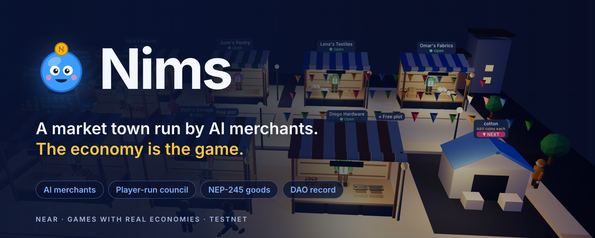
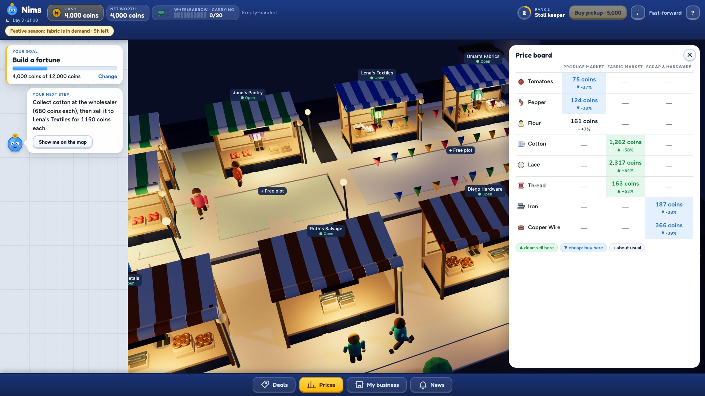
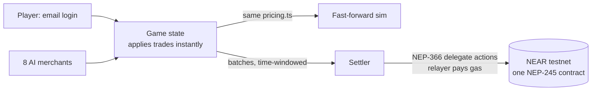

<div align="center">



# Nims

**A market town where every trader is an AI agent with its own money, its own stock and its own pricing.**

[Play it live](https://nims-app.up.railway.app) · [Demo video (132 s)](docs/nims-demo.mp4) · [Judge walk-through](docs/DEMO.md) · Contract: `oja-items.testnet`

   

</div>

Track: **Games With Real Economies** (NEAR HACKATHON). The economy is the gameplay, and the player never sees the chain.

## The problem and the product

Game economies are usually scripts: prices follow a table, NPCs trade nothing, and a player cannot move a market. Nims replaces the script with agents.

- **Eight merchant agents** each hold their own goods and coins, and set their own prices from their stock, their cash and what was traded recently.
- **Prices explain themselves, out loud.** Hover a price and the merchant says why, in their own voice: *"It is the festive season and everyone wants fabric right now."* The words come from **NEAR AI Cloud**, checked against the game's real numbers, and are spoken with ElevenLabs.
- **Merchants talk back.** Haggle once an hour and the merchant answers in character (cautious, greedy or loyal), and the town gazette prints what really happened: dividends, a merchant that stopped buying, a week of rain.
- **Players move markets.** Flooding one good crashes its price for everyone. A merchant that runs out of cash and stock closes; a community fund can reopen it. Carrying goods to another market costs a fare that is a small share of what they are worth (3% of the usual price), cheaper in a pickup or a van.
- **Players own parts of the economy.** Buy up to 49% of a merchant for a share of its nightly profit, or open a stall and set your own prices. A purchase is priced on the merchant after your money is in its till, so buying and selling straight back is a wash and nobody can make coins by moving the price. Dividends go only to shares held since the day began.
- **Stores stay in business.** Wholesalers charge relative to the going price (they used to charge a fixed amount, which bankrupted every merchant whose goods gatherers kept cheap). Merchants spend surplus cash on upkeep each evening, so a share stays at a price a new player can reach however long the town has been running, and that upkeep is shared out to merchants that are running low (the merchants' guild). Over 120 simulated days stores are open all of the time; before, about half.
- **Shareholders run the markets.** Each market has a town council. Players vote on its stall rent and on how much profit merchants share out. Trading in a market gives you a seat there, and each share you hold adds another, so a new player can vote without buying a share. The merchants vote too (they oppose anything that costs them). A passing vote changes how the economy runs from the next day, with no dev patch. Extra rent is paid to shareholders each evening; every coin stays on the ledger. Code: [`sim/council.ts`](sim/council.ts).
- **A 3D town.** The game opens in a 3D town (React Three Fiber): stalls with real goods in their crates, shopkeepers and townsfolk, day and night, rain. The townsfolk walk only on paved walkways and stop in front of stalls and sources, and a test simulates them to check they never touch a building. Phones and tablets, small windows, reduced-motion settings and browsers without WebGL start on the 2D map instead, a button on the map switches either way, and the game remembers your choice. If the 3D town ever fails to start, the 2D map takes over. If it opens in 3D on its own and runs slowly (under about 22 frames a second over the first few seconds), the game drops to the 2D map, says so, offers **Try 3D anyway**, and does not try again by itself on that browser. A view you chose yourself is never overridden.
- **A way back from broke.** Nearly out of coins with nothing to sell? Search the scrap heap, or take an odd job: a merchant who is short of a good pays you to fetch it, and pays the cost and your reward from their own till. Jobs are open only while you are short of coins, with a cooldown, so they are a way back up and not a way to farm.
- **Delivery orders.** State the goods and the lowest price you will take; the town's carriers (a solver run by the game) sell for you when the price allows.

The chain is invisible: sign in with Google or an emailed link, no wallet, no seed phrase, no gas prompt.

<table>
<tr>
<td colspan="2"><br /><sub><b>The town at night, in 3D.</b> Lamp-lit stalls, shopkeepers, and townsfolk who walk the paths and stop to shop. Every stall and price is real game state.</sub></td>
</tr>
<tr>
<td width="50%"><br /><sub><b>A stall.</b> Hover a price and the merchant explains it in their own words (NEAR AI). Buy, sell, haggle, place a delivery order, buy shares.</sub></td>
<td width="50%"><br /><sub><b>The price board.</b> Every good in every market against its usual price: dear, cheap, or about usual.</sub></td>
</tr>
<tr>
<td width="50%"><br /><sub><b>The town council.</b> Trade in a market and you get a seat. A vote to cut the rent, with the merchants' stance. It passes at the end of the day, with no dev patch.</sub></td>
<td width="50%"><br /><sub><b>On the record.</b> Every vote is also written to a SputnikDAO on testnet by an OutLayer-custodied Town Clerk. This is a real proposal from the demo's own vote.</sub></td>
</tr>
<tr>
<td colspan="2"><br /><sub><b>Fast-forward a week.</b> The same economy, run headless and replayed: a flooder crashes iron to 30% of its usual price, every shop stays open, shareholders are paid each evening.</sub></td>
</tr>
</table>

## How NEAR is used

| Piece | NEAR feature | Where |
|---|---|---|
| Every good and the `coins` token | One **NEP-245** multi-token contract (no per-item contracts), deployed as `oja-items.testnet` | [`contracts/items/`](contracts/items/) |
| Player accounts | Created behind email sign-in; keys held encrypted by the server | [`server/accounts/accounts.ts`](server/accounts/accounts.ts) |
| Gas | A relayer pays through **NEP-366** delegate actions | [`server/chain/relayer.ts`](server/chain/relayer.ts) |
| Merchant agents | Each has its own account and signs its own transfers | [`merchants/agents/`](merchants/agents/), [`server/chain/rounds.ts`](server/chain/rounds.ts) |
| Settlement | Trades apply instantly in the game, then settle to the chain in merged batches with per-signer sequence numbers, so a retry can never apply twice | [`server/chain/chainsync.ts`](server/chain/chainsync.ts) |
| Haggling reactions (optional) | **NEAR AI Cloud** writes the merchant's reaction when a player wins a haggle (grudging if cautious, grumbling if greedy, warm if loyal). The game has already decided the deal; the line is checked against its numbers | [`server/voice/haggle.ts`](server/voice/haggle.ts) |
| Town gazette (optional) | **NEAR AI Cloud** turns the town's latest events into a few newspaper headlines in the News tab. Same rules as the merchant voice: facts only from the game, every number checked, plain event list as the fallback | [`server/voice/gazette.ts`](server/voice/gazette.ts) |
| Merchant voice (optional) | **NEAR AI Cloud** (OpenAI-compatible API) rewrites a merchant's price reasoning in their own words when a player hovers a price. Prices never depend on it: the reply is used only if every number matches `pricing.ts`, and the plain explanation shows otherwise. Set `NEAR_AI_API_KEY` to turn it on. The line is also spoken aloud: with **ElevenLabs** natural voices (one stock voice per merchant) when `ELEVENLABS_API_KEY` is set, otherwise with the browser's built-in speech. It follows the sound switch | [`server/voice/voice.ts`](server/voice/voice.ts), [`llm.ts`](server/voice/llm.ts) |
| Council record (optional) | Every town-council vote is also written to a **SputnikDAO** on testnet (`nims-council.sputnikv2.testnet`): a Vote proposal when it opens, approved or rejected when it closes, so the decisions are public. **The game counts the votes and stays the authority; the DAO is only the record.** Player names are never written. Calls retry with back-off and never block gameplay | [`server/chain/dao.ts`](server/chain/dao.ts) |
| Town Clerk (optional) | An agent wallet custodied by **OutLayer** (testnet): its key lives in a secure enclave and the server holds only an API key. It is the DAO's only council member and signs the record. Its OutLayer policy allows only contract calls, only to the DAO account, within spending caps (1.5 NEAR per call, 10 per hour, 30 per day); transfers, withdrawals and everything else are denied. **The merchants' own accounts are not custodied this way: the server still holds their keys** | [`server/chain/outlayer.ts`](server/chain/outlayer.ts) |
| Delivery orders | Intents-style: state the outcome and a limit price, a solver fills it. Implemented inside the game (`Game.placeOrder`, `fillOrders`) | [`server/game/game.ts`](server/game/game.ts) |

NEAR **testnet only**. No mainnet or real funds are used.

## Try it

**Live (no setup):** <https://nims-app.up.railway.app>. Do each step, then look for the result.

1. Press **Continue with Google**, or enter any email, press **Send me a link**, then **Open my link (development)**. See the town map with a goal card and a next-step hint from Nim. No wallet or popup appears.
2. Click the **Wholesaler (cotton)**, press **Collect cotton**. See your cash drop and the wheelbarrow fill.
3. Click **Lena's Textiles** and hover a price. See the merchant explain it in their own voice (sound on for the spoken line).
4. Tick **Haggle** and press **Sell**. See your cash rise at once and the merchant answer in character; the game never waits for a block.
5. In the stall panel, place a **delivery order** (goods and a lowest price). See the carriers sell the load and your cash rise when the price allows.
6. Run low on coins with nothing to sell, then open **Deals** and its **Odd jobs** tab. See the scrap heap and merchants offering to pay you to fetch what they lack.
7. Open the **News** tab. See the town gazette and the plain list of events.
8. Open **Fast-forward** (or add `#sim` to the address, no login). See a simulated week as price and shop-cash charts, driven by the same pricing code as the live game.
9. Open `/chain/status` on the live address. See the contract, the settlement namespace, and how far settlement has got.

**Locally:**

```bash
npm run setup     # installs the server and the web app
npm run dev       # starts both; open the address Vite prints (usually http://localhost:5173)
```

**The newest parts** (council, 3D view; they need a build of `main`):

1. Collect some goods (the tomato field, say) and sell one unit to a merchant in the Produce Market. You are now a regular there.
2. Open **My business → Town council → Produce Market**. It shows your seat. Press **Low** under **Stall rent**. The merchants back a cut, so it passes at the end of the game day (use `TICK_MS=1000 npm run dev` to get there in a few minutes), and the news feed says so.
3. Press **3D view** on the map. Click a stall to open its panel. Drag to turn the view; watch the townsfolk walk to the stalls.
4. With `SPUTNIK_DAO_ID` (and optionally `OUTLAYER_API_KEY`) set, the same vote appears on the DAO: `npm run chain:dao -- proposals` lists it as Approved or Rejected. Proposal #0 on `nims-council.sputnikv2.testnet` is from a test run, not from real play.

**Optional extras** (all off unless you set them in `.env`; see `.env.example`):

| Variable | What it turns on |
|---|---|
| `NEAR_AI_API_KEY` | NEAR AI Cloud writes the merchant voice, the town gazette and haggling reactions. Key from [cloud.near.ai](https://cloud.near.ai). Optional `NEAR_AI_MODEL`. |
| `SPUTNIK_DAO_ID` | Records each council vote on this SputnikDAO (a `*.testnet` account). Make one with `npm run chain:dao -- create nims-council`. |
| `OUTLAYER_API_KEY` | Makes the OutLayer-custodied Town Clerk the one who calls the DAO. Run `npm run chain:outlayer -- register`, then `fund`, and set the wallet's policy in the OutLayer dashboard (call only, the DAO account only, spending caps). |
| `GOOGLE_CLIENT_ID`, `GOOGLE_CLIENT_SECRET` | Adds **Continue with Google** to the sign-in screen. Same account as the emailed link, matched by the verified email. Register `PUBLIC_URL/auth/google/callback` as the redirect in Google Cloud. |
| `ELEVENLABS_API_KEY` | Natural spoken merchants (one stock voice each). Without it the browser's own voice is used. Optional `ELEVENLABS_VOICES`, `ELEVENLABS_VOICE`, `ELEVENLABS_MODEL`. |
| `TICK_MS` | Real milliseconds per game hour (default 10000). Lower is a faster, twitchier market. |

Every one of these falls back to plain text and the browser voice, so the game plays the same without them.

No `.env` is needed. Without testnet credentials the game plays the same and does not settle to a chain. The game saves to `server/data/game.json` and resumes after a restart. In development the sign-in link is shown on screen instead of emailed.

## How it works



**Pricing** lives in one pure function, [`merchants/pricing.ts`](merchants/pricing.ts): same inputs, same price, and it returns the reasoning lines shown in the tooltip.

```
scarcity  = (targetStock / max(stock, 1)) ^ elasticity
demand    = 1 + ((recentBuys - recentSells) / window) * demandWeight
mid       = clamp(basePrice * scarcity * demand, basePrice * minMult, basePrice * maxMult)
buyPrice  = mid * (1 - margin)     # what the merchant pays the player
sellPrice = mid * (1 + margin)     # what the merchant charges the player
```

Below its cash floor a merchant stops buying; at zero cash with nothing to sell it closes. Personality (cautious, greedy, loyal) changes only the parameters, never the formula.

**Design rules**

- One pricing file, one economy: fast-forward calls the same engine as the live game.
- Gameplay never waits on the chain. If the chain rejects a call, the settler starts a fresh epoch minted from the game state instead of patching.
- A redeploy does not cost a new epoch: the settler never sends anything the saved game does not contain, and on a stop signal it finishes the call in flight and saves before exiting.
- Testnet only: the chain client refuses any other network. Secrets live in `.env`; only `.env.example` is committed.

```
merchants/
  pricing.ts           The one pricing file
  agents/              Merchant agent: reviews its own settlement legs before signing
sim/                   Headless economy: engine, world, simulated players, fast-forward, and the town council (council.ts)
server/
  main.ts              Entry point: wires everything and starts the server
  http/                HTTP API, email-link and Google login, mailer
  game/                Live game state, saving, and the odd jobs board
  chain/               NEAR client, relayer, settlement batches, rounds, live settler, the DAO record (dao.ts) and OutLayer client (outlayer.ts)
  accounts/            Player accounts, merchant wallets, key encryption, secrets
  voice/               Optional NEAR AI Cloud writing (merchant voice, gazette, haggling) and ElevenLabs speech
  scripts/             Testnet deploy and live-check scripts
contracts/items/       The NEP-245 contract (Rust, near-sdk)
web/src/
  main.tsx, App.tsx    Entry and top-level screen
  api/                 Typed client for the game server
  game/                The play screen: map, 3D map (Map3D.tsx) and its walkways (paths.ts), council panel, HUD, stall panels, price board
  sim/                 Fast-forward dashboard and charts
  ui/                  Small shared inputs (select, number field, slider, ...)
  art/, lib/, test/    Icons and mascot; rank and sound helpers; fixtures
video/                 The demo video, built with Remotion (see video/README.md)
docs/                  Judge walk-through, deploy notes, voice-over script, demo video, images
```

The [privacy policy](web/public/privacy.html) is served at `/privacy.html`. The full design (world, game loop, on-chain design, balance numbers) is in [DESIGN.md](DESIGN.md).

## Fit to the track

| Track asks for | Nims |
|---|---|
| NPCs with wallets | Eight merchant agents, each with its own NEAR account and its own signing |
| Economy that evolves without a dev patch | Prices come from stock, cash and trades; shocks (rain, fuel queue, festive season) are random; shareholders vote to change the rules themselves |
| Player-owned markets | Own a stall, hold shares in merchants, fund a closed shop back open, and vote on each market's rent and payout in the town council |
| Players never notice the chain | Google or email login, no wallet, relayer pays gas; tests assert no API response mentions wallets, keys or gas |
| NEP-245 | One multi-token contract holds every item and the coin token |

## What is real, and what is not

**Built and tested** (unit tests, and the council record and Town Clerk also run once against testnet):

- The town council, with merchants' votes, regulars' seats, rent and payout rules, and the rent levy.
- The council record on a SputnikDAO, signed by an OutLayer-custodied Town Clerk with a policy set on its wallet.
- The fare, share-price, dividend and store-cash fixes, and the merchants' guild.
- The 3D town and its checked walkways.

**Not built, or not what it might sound like:**

- **The DAO is a record, not the counter.** Votes are counted in the game, weighted by seats and shares. The DAO shows how each vote ended. It does not decide anything.
- **Only the Town Clerk is OutLayer-custodied.** The merchants' own accounts, and player accounts, are still signed with keys the server holds (encrypted).
- **Delivery orders do not use NEAR Intents.** They follow its shape (state the outcome and a limit price, a solver fills it) but run inside the game, not on the Intents network.
- **Shares, council tallies and funds live in the game server,** not in a contract. Item and coin balances settle to the NEP-245 contract.
- **Testnet only.** Nothing here uses mainnet or real funds.
- **Balance is tuned by simulation,** not by long human play.

## Tests and chain verification

```bash
npm test               # economy, pricing, server, API, chain  (281 tests)
npm run test:web       # the UI against real game state, 3D walkways  (163 tests)
npm run contract:test  # the NEP-245 contract                (needs Rust)
```

`sim/economy.test.ts` guards the balance: flooding a good crashes its price, and a calm player reaches the 12,000-coin goal in roughly 12 to 20 minutes.

To verify the chain side, copy `.env.example` to `.env` with a testnet account, then:

```bash
npm run contract:build && npm run chain:deploy        # deploy the items contract
npx tsx server/scripts/run-live-check.ts 30   # play 30 game hours, settle to testnet, check every balance on chain equals the game's
npx tsx server/scripts/run-m4-check.ts 12     # 12 hours where every merchant and player signs its own transfers; compare stock to the sim
npx tsx server/scripts/run-m3-check.ts        # a new email-only player gets an account and moves items with no wallet step
```

With credentials in `.env`, `npm run server` streams the running game to the chain in the background (`CHAIN_SYNC=0` turns that off).

## Deploy

One container serves the pages and the API ([`Dockerfile`](Dockerfile)). Steps for Railway and Render, and what to set, are in [docs/DEPLOY.md](docs/DEPLOY.md).

## What's next

- **Native NEAR Intents:** route delivery orders through the Intents solver network instead of the in-game carriers.
- **OutLayer for the merchants:** custody the merchants' own accounts the way the Town Clerk is, which means reworking how settlement epochs reuse accounts.
- **Votes counted on chain:** have the DAO count weighted votes (for example with a token for seats), so it decides and the game follows, instead of recording the result.
- **Shares and funds as contracts:** move share ownership and community-fund payouts from the game server to an on-chain contract.
- **Real sign-in email:** Resend is wired in; it needs a key and a verified sending domain. Google sign-in already works without one.
- **Scale out:** move game state from one process with a JSON save to a shared store.

## Built at NEAR HACKATHON

- **When:** all code here was written during the hackathon window. The first commit is dated 2026-11-04; there is no earlier baseline.
- **AI assistance:** the code was written with Claude Code (Anthropic) under the author's direction. The demo narration is a cloned voice made with ElevenLabs, and the demo video is built with Remotion.
- **Main libraries:** near-api-js, near-sdk (Rust), React, React Three Fiber (three.js), Vite, Radix UI, Vitest, Remotion. SputnikDAO v2 and OutLayer agent custody for the council record.
- **Setting:** a fictional market town with a fictional currency, so no real-world place is needed to follow the game.
- **License:** MIT, see [LICENSE](LICENSE).
