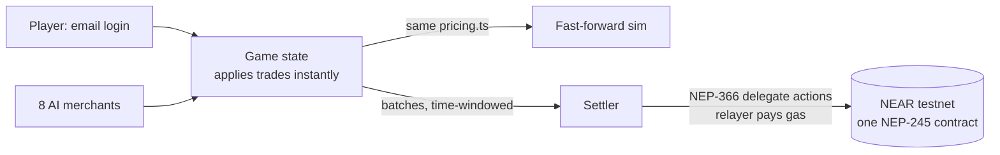

<div align="center">


**A market town where every trader is an AI agent with its own money, its own stock and its own mind about prices.**
Start with a wheelbarrow. Read the market. End up owning a piece of half the stalls.

[▶ Watch the 100-second demo](docs/nims-demo.mp4) · [Judge walk-through](docs/DEMO.md) · Contract: `oja-items.testnet`

   

</div>

Built for the **Games With Real Economies** track on NEAR. The economy *is* the gameplay, and the player never notices the chain.

## The idea in one minute

In most games the economy is a spreadsheet: prices never move and nobody is really trading. In Nims every merchant is an agent that holds real goods and real coins, and changes its prices as the town changes.

- A merchant sitting on too much iron pays less for it. A flood of cotton from one player drops the price for everyone.
- Hover any price and the merchant explains it in plain words: *"I'm holding 140 iron and I only want 50. Four people sold me iron this hour."*
- A shop that runs out of cash closes. Neighbours can reopen it through a community fund and put their names on the sign.
- You can own up to 49% of a merchant and earn a share of its profit every evening.

Underneath, every good and every coin is a token on NEAR testnet. You never see that. You sign in with an email, trade, and the game settles in the background.

<table>
<tr>
<td width="50%"><br /><sub><b>A stall.</b> Buy, sell, send a delivery order, or buy shares.</sub></td>
<td width="50%"><br /><sub><b>The price board.</b> Every good in every market, against its usual price.</sub></td>
</tr>
<tr>
<td colspan="2"><br /><sub><b>Fast-forward a week.</b> The same economy, headless, played back as charts: price swings, shocks, shops closing.</sub></td>
</tr>
</table>

## Why it fits the track

| What judges look for | Where it is |
|---|---|
| **The economy is the gameplay** | Prices come from merchant stock, cash and recent trades, not from a script. Flooding a market really crashes it. [`merchants/pricing.ts`](merchants/pricing.ts) |
| **Agent NPCs** | Eight merchants, each with its own account and personality (cautious, greedy, loyal). Each reviews its own settlement legs and signs its own transfers. [`merchants/agents/`](merchants/agents/) |
| **The player never notices the chain** | Email sign-in, no wallet, no seed phrase, no gas prompt. A relayer pays gas through NEP-366 delegate actions. Tests assert that no API response mentions wallets, keys or gas. |
| **NEP-245 items** | One multi-token contract holds every item type *and* the `coins` token. No per-item contracts. [`contracts/items/`](contracts/items/) |
| **Intents-style trading** | Delivery orders: say what you want (*sell 10 cotton for at least 1,188 each*), and the town's carriers fill it when the price allows. Not the real Intents network, see [limits](#honest-limits). |
| **It works end to end** | 278 automated tests, a live-testnet soak that checks every balance on chain equals the game's, and a deployed contract with hundreds of settlement batches. |

## Try it (two minutes, no accounts needed)

```bash
npm run setup     # installs the server and the web app
npm run dev       # starts both; open the address Vite prints (usually http://localhost:5173)
```

1. Enter any email, press **Send me a link**, then **Open my link (development)**. In development the sign-in link is shown on screen instead of emailed.
2. Follow Nim, the guide, who always says what to do next. Collect cotton, carry it to a stall that pays more, and hover the price to hear why.
3. Open **Fast-forward** (or go to `#sim`, no login needed) to watch a whole week of the market in seconds.

No `.env` is needed. Without testnet credentials the game plays identically and just doesn't settle to a chain. The game saves itself to `server/data/game.json` and resumes after a restart.

## How it works



The rules this project holds itself to:

- **One pricing file.** All merchant prices come from `merchants/pricing.ts`, a pure function that returns the price *and* the reasoning lines for the tooltip. Personality changes parameters (`elasticity`, `demandWeight`, `margin`, `loyalty`), never the formula. Read it first: it is short and heavily commented.
- **Never block gameplay on the chain.** A trade changes game state immediately. Settlement follows within about a minute, in merged batches where every account signs its own transfers.
- **Exactly once.** Calls carry per-signer sequence numbers, so a retry after a timeout cannot apply twice. If the chain ever rejects a call, a fresh epoch is minted from the game's state instead of patching.
- **One economy.** Fast-forward calls the same engine as the live game. There is no second copy of the economy logic.
- **Testnet only.** The chain client refuses to run against anything else. Secrets live in `.env`; only `.env.example` is committed.

```
merchants/pricing.ts   The one pricing file
merchants/agents/      Merchant agent: reviews its own settlement legs before signing
sim/                   Headless economy: engine, world, simulated players, fast-forward
server/                Game state, login, relayer, batch settlement, HTTP API, saving
contracts/items/       The NEP-245 contract (Rust, near-sdk)
web/                   The game and the dashboard (Vite, React, SVG, Radix UI)
video/                 The demo video, built with Remotion (see video/README.md)
docs/                  Judge walk-through, voice-over script, demo video, images
```

The full design and the balance numbers behind the economy are in [DESIGN.md](DESIGN.md).

## What you can do in the game

| | |
|---|---|
| **Trade** | Buy at wholesale from farms, scrap spots and the cloth wholesaler, carry goods between three markets, sell where they are dear. Starting cash is the limit, so you start small. Haggle once an hour. |
| **Read the market** | The **Prices** tab tints every good green where it is dear and blue where it is cheap. On the map a flooded stall visibly overflows and a broke one has its shutters down. |
| **Order a delivery** | Name the goods and the lowest price you will take. Carriers watch the stall and sell the load for you when it pays. |
| **Revive** | A shop with no cash and no stock closes. A community fund reopens it; contributors become part-owners. |
| **Own** | Buy up to 49% of a merchant for a share of its nightly profit, or open your own stall and set your own prices. |
| **Come back** | The town kept trading while you were away. A summary says what your shares paid and what happened. |
| **Watch** | Run a simulated week with a chosen cast: gatherers, an arbitrageur, an investor, a market flooder. |

## Tests

```bash
npm test               # economy, pricing, server, API       (165 tests)
npm run test:web       # the UI against real game state      (113 tests)
npm run contract:test  # the NEP-245 contract                (needs Rust)
```

`sim/economy.test.ts` guards the balance: a calm player reaches the 12,000-coin goal in roughly 12 to 20 minutes, and flooding a good crashes its price.

## Run it against the NEAR testnet

Optional. This is how the chain side was verified.

1. Create a testnet account and copy `.env.example` to `.env` (account id and key; the key never leaves `.env`).
2. `npm run contract:build`, then `npm run chain:deploy` deploys the items contract.
3. `npx tsx server/run-live-check.ts 30` plays 30 game hours, streams them to testnet through the same settler the server uses, and verifies every goods and coin balance on chain equals the game's.
4. `npx tsx server/run-m4-check.ts 12` settles 12 simulated hours where every merchant and player signs its own transfers (the relayer only pays gas) and checks each merchant's stock against the simulation.
5. `npx tsx server/run-m3-check.ts` makes a brand-new email-only player, creates their account and moves items on chain with no wallet step.

With credentials in `.env`, `npm run server` streams the running game to the chain in the background (`CHAIN_SYNC=0` turns that off). `GET /chain/status` shows how far settlement has got. The deployed contract is `oja-items.testnet`; the account was created before the game was renamed, and an on-chain name cannot be changed.

## Host it

One container serves the pages and the API ([`Dockerfile`](Dockerfile)); any host that runs a container works (Fly.io, Railway, Render, a VM).

**Free, in about ten minutes (Render, no card):** [`render.yaml`](render.yaml) is a ready Blueprint.

1. Push the repo to GitHub. In Render choose **New, Blueprint** and pick it.
2. Fill the prompted variables: `PUBLIC_URL` (the `https://...onrender.com` address Render gives you), and the testnet ones from `.env.example` (`NEAR_RPC_URL`, `NEAR_ACCOUNT_ID`, `NEAR_PRIVATE_KEY`, `CONTRACT_ID`). Leave them empty to run without the chain. `MASTER_KEY` and `SESSION_SECRET` are generated for you.
3. Open the address. `NIMS_DEV=1` shows the sign-in link on screen so anyone can try it without email. Remove it, and set `RESEND_API_KEY` and `MAIL_FROM`, to send real emails.
4. Keep it awake during judging with a free pinger (for example UptimeRobot hitting the address every 5 minutes).

**Know the limits of a free plan:** it sleeps when idle, and its disk is wiped on restart or redeploy, so players and saves reset. For anything that should last, mount a persistent volume at `/data` (it holds accounts, wallets, chain progress and the game save) on a paid host or your own VM.

Always: run **one** copy only (the game world and the settler live in that process), and keep the settlement account funded. If it runs out of testnet NEAR, the status page says so and settlement pauses while gameplay continues. Never commit `.env`.

## Honest limits

- **Shares and fund rules are game logic.** Goods and coins are real tokens, and every contribution, dividend and revival moves real coins, but who is owed what is enforced by the game server, not by a contract.
- **The chain follows the game, it does not lead it.** Settlement catches up within about a minute.
- **Delivery orders are intents-style, not the NEAR Intents protocol.** They have the shape (state the result, a solver finds the path, a limit price is enforced) implemented inside the game. The code is `Game.placeOrder` / `fillOrders` in [`server/game.ts`](server/game.ts).
- **Sign-in links are shown on screen in development.** A real provider is a small replacement of the `Mailer` interface.
- **One server process,** state in memory with a JSON save. Fine for a demo, not horizontally scalable.
- **Free testnet RPC endpoints rate-limit.** Settlement retries with backoff; a busy demo wants a paid key.

## Credits

Built with NEAR (`near-api-js`, `near-sdk`), React, Vite, Radix UI, Vitest and Remotion. The setting is a fictional market town with a fictional currency, so no real-world place is needed to follow the game.
