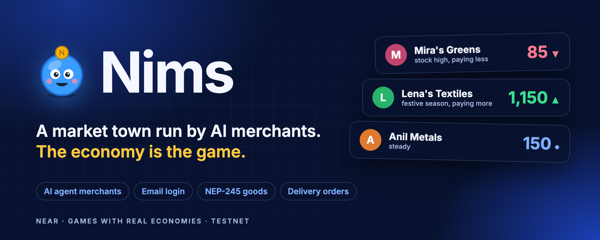
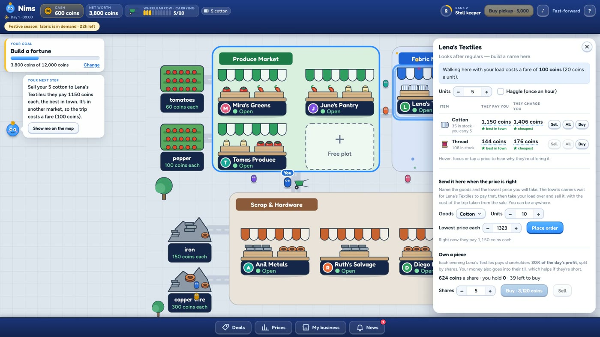
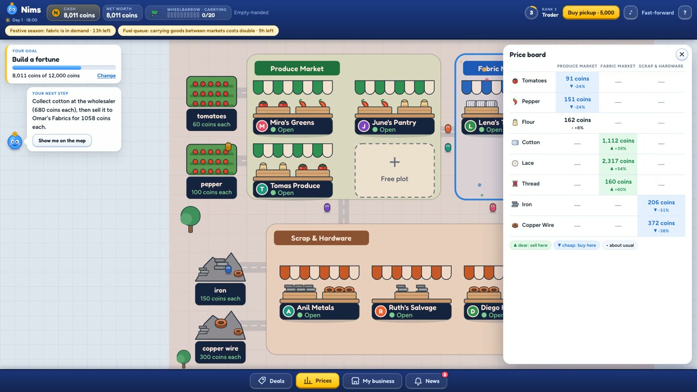
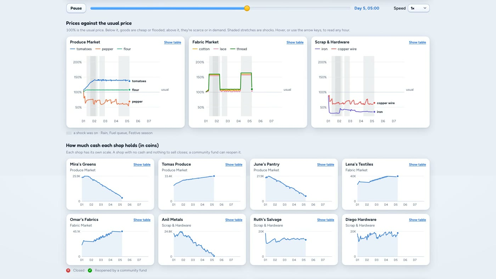
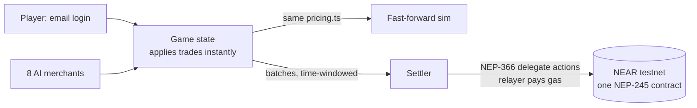

<div align="center">



# Nims

**A market town where every trader is an AI agent with its own money, its own stock and its own pricing.**

[Play it live](https://nims-app.up.railway.app) · [Demo video (100 s)](docs/nims-demo.mp4) · [Judge walk-through](docs/DEMO.md) · Contract: `oja-items.testnet`

   

</div>

Track: **Games With Real Economies** (NEAR HACKATHON). The economy is the gameplay, and the player never sees the chain.

## The problem and the product

Game economies are usually scripts: prices follow a table, NPCs trade nothing, and a player cannot move a market. Nims replaces the script with agents.

- **Eight merchant agents** each hold their own goods and coins, and set their own prices from their stock, their cash and what was traded recently.
- **Prices explain themselves.** Hover a price and the merchant says why: *"I'm holding 140 iron and I only want 50. Four people sold me iron this hour."*
- **Players move markets.** Flooding one good crashes its price for everyone. A merchant with no cash closes; a community fund can reopen it.
- **Players own parts of the economy.** Buy up to 49% of a merchant for a share of its nightly profit, or open a stall and set your own prices.
- **Delivery orders.** State the goods and the lowest price you will take; the town's carriers (a solver run by the game) sell for you when the price allows.

The chain is invisible: email sign-in, no wallet, no seed phrase, no gas prompt.

<table>
<tr>
<td width="50%"><br /><sub><b>A stall.</b> Buy, sell, place a delivery order, buy shares.</sub></td>
<td width="50%"><br /><sub><b>The price board.</b> Every good in every market against its usual price.</sub></td>
</tr>
<tr>
<td colspan="2"><br /><sub><b>Fast-forward a week.</b> The same economy, run headless and replayed: price swings, shocks, shops closing.</sub></td>
</tr>
</table>

## How NEAR is used

| Piece | NEAR feature | Where |
|---|---|---|
| Every good and the `coins` token | One **NEP-245** multi-token contract (no per-item contracts), deployed as `oja-items.testnet` | [`contracts/items/`](contracts/items/) |
| Player accounts | Created behind email sign-in; keys held encrypted by the server | [`server/accounts.ts`](server/accounts.ts) |
| Gas | A relayer pays through **NEP-366** delegate actions | [`server/relayer.ts`](server/relayer.ts) |
| Merchant agents | Each has its own account and signs its own transfers | [`merchants/agents/`](merchants/agents/), [`server/rounds.ts`](server/rounds.ts) |
| Settlement | Trades apply instantly in the game, then settle to the chain in merged batches with per-signer sequence numbers, so a retry can never apply twice | [`server/chainsync.ts`](server/chainsync.ts) |
| Merchant voice (optional) | **NEAR AI Cloud** (OpenAI-compatible API) rewrites a merchant's price reasoning in their own words when a player hovers a price. Prices never depend on it: the reply is used only if every number matches `pricing.ts`, and the plain explanation shows otherwise. Set `NEAR_AI_API_KEY` to turn it on | [`server/voice.ts`](server/voice.ts) |
| Delivery orders | Intents-style: state the outcome and a limit price, a solver fills it. Implemented inside the game (`Game.placeOrder`, `fillOrders`) | [`server/game.ts`](server/game.ts) |

NEAR **testnet only**. No mainnet or real funds are used.

## Try it

**Live (no setup):** <https://nims-app.up.railway.app>. Do each step, then look for the result.

1. Enter any email, press **Send me a link**, then **Open my link (development)**. See the town map with a goal card and a next-step hint from Nim. No wallet or popup appears.
2. Click the **Wholesaler (cotton)**, press **Collect cotton**. See your cash drop and the wheelbarrow fill.
3. Click **Lena's Textiles** and hover a price. See the merchant explain it in plain words.
4. Press **Sell**. See your cash rise at once; the game never waits for a block.
5. In the stall panel, place a **delivery order** (goods and a lowest price). See the carriers sell the load and your cash rise when the price allows.
6. Open **Fast-forward** (or add `#sim` to the address, no login). See a simulated week as price and shop-cash charts, driven by the same pricing code as the live game.
7. Open `/chain/status` on the live address. See the contract, the settlement namespace, and how far settlement has got.

**Locally:**

```bash
npm run setup     # installs the server and the web app
npm run dev       # starts both; open the address Vite prints (usually http://localhost:5173)
```

No `.env` is needed. Without testnet credentials the game plays the same and does not settle to a chain. The game saves to `server/data/game.json` and resumes after a restart. In development the sign-in link is shown on screen instead of emailed.

## How it works



**Pricing** lives in one pure function, [`merchants/pricing.ts`](merchants/pricing.ts): same inputs, same price, and it returns the reasoning lines shown in the tooltip.

```
scarcity  = (targetStock / max(stock, 1)) ^ elasticity
demand    = 1 + ((recentBuys - recentSells) / window) * demandWeight
mid       = clamp(basePrice * scarcity * demand, basePrice * minMult, basePrice * maxMult)
buyPrice  = mid * (1 - margin)     # what the merchant pays the player
sellPrice = mid * (1 + margin)     # what the merchant charges the player
```

Below its cash floor a merchant stops buying; at zero cash with nothing to sell it closes. Personality (cautious, greedy, loyal) changes only the parameters, never the formula.

**Design rules**

- One pricing file, one economy: fast-forward calls the same engine as the live game.
- Gameplay never waits on the chain. If the chain rejects a call, the settler starts a fresh epoch minted from the game state instead of patching.
- Testnet only: the chain client refuses any other network. Secrets live in `.env`; only `.env.example` is committed.

```
merchants/pricing.ts   The one pricing file
merchants/agents/      Merchant agent: reviews its own settlement legs before signing
sim/                   Headless economy: engine, world, simulated players, fast-forward
server/                Game state, login, relayer, batch settlement, HTTP API, saving
contracts/items/       The NEP-245 contract (Rust, near-sdk)
web/                   The game and dashboard (Vite, React, SVG, Radix UI)
video/                 The demo video, built with Remotion (see video/README.md)
docs/                  Judge walk-through, deploy notes, voice-over script, demo video, images
```

The full design (world, game loop, on-chain design, balance numbers) is in [DESIGN.md](DESIGN.md).

## Fit to the track

| Track asks for | Nims |
|---|---|
| NPCs with wallets | Eight merchant agents, each with its own NEAR account and its own signing |
| Economy that evolves without a dev patch | Prices come from stock, cash and trades; shocks (rain, fuel queue, festive season) are random |
| Player-owned markets | Own a stall, hold shares in merchants, fund a closed shop back open |
| Players never notice the chain | Email login, no wallet, relayer pays gas; tests assert no API response mentions wallets, keys or gas |
| NEP-245 | One multi-token contract holds every item and the coin token |

## Tests and chain verification

```bash
npm test               # economy, pricing, server, API       (179 tests)
npm run test:web       # the UI against real game state      (116 tests)
npm run contract:test  # the NEP-245 contract                (needs Rust)
```

`sim/economy.test.ts` guards the balance: flooding a good crashes its price, and a calm player reaches the 12,000-coin goal in roughly 12 to 20 minutes.

To verify the chain side, copy `.env.example` to `.env` with a testnet account, then:

```bash
npm run contract:build && npm run chain:deploy        # deploy the items contract
npx tsx server/run-live-check.ts 30   # play 30 game hours, settle to testnet, check every balance on chain equals the game's
npx tsx server/run-m4-check.ts 12     # 12 hours where every merchant and player signs its own transfers; compare stock to the sim
npx tsx server/run-m3-check.ts        # a new email-only player gets an account and moves items with no wallet step
```

With credentials in `.env`, `npm run server` streams the running game to the chain in the background (`CHAIN_SYNC=0` turns that off).

## Deploy

One container serves the pages and the API ([`Dockerfile`](Dockerfile)). Steps for Railway and Render, and what to set, are in [docs/DEPLOY.md](docs/DEPLOY.md).

## What's next

- **Native NEAR Intents:** route delivery orders through the Intents solver network instead of the in-game carriers.
- **Shares and funds as contracts:** move share ownership and community-fund payouts from the game server to an on-chain contract.
- **Real sign-in email:** plug a mail provider into the `Mailer` interface (Resend is wired in and needs a key).
- **Scale out:** move game state from one process with a JSON save to a shared store.

## Built at NEAR HACKATHON

- **When:** all code here was written during the hackathon window. The first commit is dated 2026-11-04; there is no earlier baseline.
- **AI assistance:** the code was written with Claude Code (Anthropic) under the author's direction. The demo narration is a cloned voice made with ElevenLabs, and the demo video is built with Remotion.
- **Main libraries:** near-api-js, near-sdk (Rust), React, Vite, Radix UI, Vitest, Remotion.
- **Setting:** a fictional market town with a fictional currency, so no real-world place is needed to follow the game.
- **License:** MIT, see [LICENSE](LICENSE).
